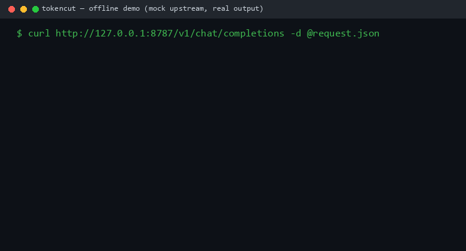

# tokencut

A local proxy that puts your LLM prompts on a token diet. Drop it between
your app and any OpenAI-compatible API and it compresses the bulky parts of
each request (tool outputs, JSON blobs, logs) before they reach the model.
The model still gets valid JSON, just less of it.

llm · proxy · context-compression · golang

[](https://github.com/attnstack/tokencut/actions/workflows/ci.yml)
[](LICENSE)

[中文说明](README.zh-CN.md)

## Why

Agent and RAG prompts are mostly tool output. A GitHub API response, a log
dump, a file read: thousands of tokens where the model only needs a few
fields. The usual fixes all have problems:

- Truncation cuts the tail off and the field you needed was in the tail.
- Generic text compression (token dropping etc.) turns JSON into something
  the model can no longer parse, which is often worse than not compressing.
- SDK approaches make you change application code.

tokencut folds JSON structurally: whole subtrees get replaced with small
markers like `{"_omitted": 412}`, so what arrives at the model is still
valid JSON with the shape intact. Logs get template-mined instead of
sampled. Everything is deterministic, so the same input always compresses
to the same output.



## Quick start

No API key needed for this part; there's a built-in mock upstream:

```bash
go build -o bin/tokencut ./cmd/tokencut
./bin/tokencut --mock-upstream        # listens on 127.0.0.1:8787
```

Then point your client at it and watch the response headers:

```bash
curl http://127.0.0.1:8787/v1/chat/completions \
  -H 'Content-Type: application/json' \
  -d '{"model":"gpt-4o","messages":[...]}'

# x-tokencut-original-tokens: 28232
# x-tokencut-compressed-tokens: 6894
# x-tokencut-ratio: 0.76
```

For real use, run without `--mock-upstream` and set the upstream
(`TOKENCUT_UPSTREAM` env or config file). Your client only changes its
base_url. There's a dashboard at `/dashboard` and Prometheus metrics at
`/metrics`.

## Benchmarks

Ran the full 250-task suite through a real model (qwen2.5:7b on Ollama,
16k context, temperature 0, 1750 calls). Full methodology and the
reproduction commands live in
[bench/benchmark-methodology.md](bench/benchmark-methodology.md).

| subset | no compression | lossless | 50% | 60% | 70% | 90% |
|---|---|---|---|---|---|---|
| T1 JSON QA (n=100) | 100% | 100% | 100% | 100% | 100% | **100% (92% compressed)** |
| T2 log triage (n=50) | 0% | 0% | **100% (99%)** | 100% | 100% | 100% |
| T3 code QA (n=50, judged) | 74% | 74% | 74% | 74% | 74% | 74% |
| T4 record QA (n=50) | 100% | 98% | 100% | 100% | 100% | 100% |

Task success is exact-match (T1/T2/T4) or rubric-judged (T3). Across the
whole run, 46.9M input tokens went down to 8.7M (81.4% saved), and average
end-to-end latency dropped from 2.24s to under a second because the model
spends less time reading.

The T2 row is the interesting one. Those log payloads are 107k to 151k
tokens, way past a 16k window. Without compression the model sees roughly
the first 15% of the log, the injected fault is nowhere in view, and it
answers all 50 tasks with the same made-up address. Compressed to about a
thousand tokens it gets 50 out of 50. At this payload size compression
isn't a cost optimization, it decides whether the task is possible at all.

T3 sits at 74% on every tier, including no compression. Those payloads are
small and barely compress; the number reflects what a 7B model can do with
the questions, not what compression does to it. Reported as-is.

Compression speed, measured with `go test -bench` on a Ryzen 7 7735H:

| workload | size | time |
|---|---|---|
| JSON pruning | 44 KB | 1.44 ms |
| lossless canonicalization | 44 KB | 0.39 ms |
| log template mining | 10k lines | 31.9 ms |
| full request pipeline | 98 KB | 22.6 ms |

One honest note: pruning goes superlinear past ~100KB because ancestor
estimates are refreshed on every fold. Fine for typical tool outputs, worth
fixing if you push half-megabyte payloads through.

## How it works

Each message is classified (JSON / log / code / html / table / text) and
routed to a compressor:

- **JSON pruning** scores every subtree by an information estimate, then
  greedily folds the cheapest-information-per-token-saved subtrees into
  markers until the budget is met. Whole-node operations only, so the
  output is valid JSON by construction, and a fuzzer holds that invariant.
  Fields the query actually mentions (keys and exact values) are protected.
- **Log mining** is a Drain-style template extractor: 10,000 lines become
  a few dozen templates with counts and variable samples. Template
  structure survives; per-line parameter association does not.
- **Dedup and diff** handle the multi-turn case: identical re-sent content
  collapses to a pointer, and a re-read file collapses to a change set.

The proxy itself is `httputil.ReverseProxy` with `FlushInterval = -1`, so
SSE streams pass through chunk by chunk with no added buffering. Anything
the pipeline can't parse, times out on (30ms wall-clock budget), or panics
on gets forwarded as the original bytes. Compression never fails a
request.

Zero third-party dependencies. One Go binary.

## Configuration

`config.example.yaml` documents every option; the proxy runs fine with
none. Tier, target ratio, exemptions, cache, rate limit, pricing for the
saved-USD estimate, and per-kind token-estimation constants (calibrated
against tiktoken, see `bench/calibrate.py`). Per-request overrides work by
adding a `"tokencut": {...}` field to the request body; it's stripped
before forwarding.

## Limitations

- The task set is synthetic. Shape-realistic, but not production traffic.
- Evaluated on one small local model. Bigger models may tolerate lossy
  compression differently (probably better).
- Code compression only strips full-line comments and blank lines. No AST
  tricks yet.
- Folded content can't be expanded on demand by the model. That's the
  obvious next feature: a marker the model can reference to request the
  original from the proxy's cache.
- Single process. Observability and cache are in-memory.

## License

MIT
