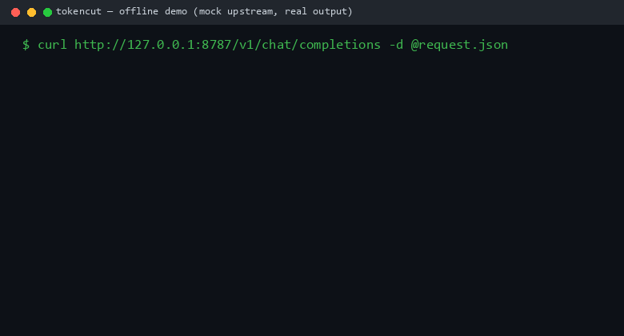

# tokencut

一个给 LLM 提示词"瘦身"的本地代理。把它放在你的应用和任何 OpenAI 兼容 API
之间，请求里最占地方的部分（工具输出、JSON、日志）在到达模型之前就被压缩掉，
模型拿到的仍然是合法 JSON，只是更小。

[English](README.md)

[](https://github.com/attnstack/tokencut/actions/workflows/ci.yml)
[](LICENSE)

## 为什么需要它

Agent / RAG 的提示词大头是工具输出。一个 GitHub API 响应、一段日志、一次
文件读取：几千个 token 里模型真正需要的只有几个字段。常见的处理方式都有硬伤：

- 截断会把尾部切掉，而你要的字段往往就在尾部。
- 通用文本压缩（按 token 丢弃那种）会把 JSON 压成模型解析不了的东西，经常
  比不压还糟。
- SDK 方案要改业务代码。

tokencut 的做法是结构化折叠：整个子树替换成 `{"_omitted": 412}` 这样的小
标记，模型收到的还是合法 JSON，schema 骨架还在。日志则做模板归并而不是抽样。
全流程确定性，同样的输入永远得到同样的输出。



## 快速开始

不需要 API key，内置了一个 mock 上游：

```bash
go build -o bin/tokencut ./cmd/tokencut
./bin/tokencut --mock-upstream        # 默认监听 127.0.0.1:8787
```

把客户端的 base_url 指过来，看响应头：

```bash
curl http://127.0.0.1:8787/v1/chat/completions \
  -H 'Content-Type: application/json' \
  -d '{"model":"gpt-4o","messages":[...]}'

# x-tokencut-original-tokens: 28232
# x-tokencut-compressed-tokens: 6894
# x-tokencut-ratio: 0.76
```

实际使用时去掉 `--mock-upstream`，用 `TOKENCUT_UPSTREAM` 环境变量或配置文件
指定真实上游。客户端只改一行 base_url。`/dashboard` 有面板，`/metrics` 是
Prometheus 格式。

## 基准数字

250 条任务 × 7 个压缩档跑过真实模型（qwen2.5:7b，Ollama，16k 上下文，
temperature=0，共 1750 次调用）。完整口径和复现命令在
[bench/benchmark-methodology.md](bench/benchmark-methodology.md)。

| 子集 | 不压缩 | lossless | 50% | 60% | 70% | 90% |
|---|---|---|---|---|---|---|
| T1 JSON 问答 (n=100) | 100% | 100% | 100% | 100% | 100% | **100%（压 92%）** |
| T2 日志定位 (n=50) | 0% | 0% | **100%（压 99%）** | 100% | 100% | 100% |
| T3 代码理解 (n=50, judge) | 74% | 74% | 74% | 74% | 74% | 74% |
| T4 记录检索 (n=50) | 100% | 98% | 100% | 100% | 100% | 100% |

T1/T2/T4 用确定性精确匹配判分，T3 用 rubric judge。整个 run 累计
46.9M token 压到 8.7M（省 81.4%），平均端到端延迟从 2.24s 降到一秒以内，
因为模型花在读上下文上的时间少了。

T2 那一行值得单独说。这批日志载荷有 10.7 万到 15.1 万 token，远超 16k 窗口。
不压缩时模型只看得到开头 15%，注入的故障根本不在窗口里，于是 50 题全部回答
同一个编造出来的地址。压缩到一千 token 左右之后，50 题全对。这个量级下压缩
不是省钱手段，它决定任务能不能做。

T3 所有档位都是 74%，包括不压缩。这类载荷本来就小，压不动，这个数字反映的
是 7B 模型自己的水平，和压缩无关，照实报告。

压缩本身的速度（`go test -bench`，Ryzen 7 7735H，多次运行取最优）：

| 场景 | 大小 | 耗时 |
|---|---|---|
| JSON 剪枝 | 44 KB | 0.86 ms |
| JSON 剪枝 | 450 KB | 6.3 ms（27.7 MB/s） |
| 无损规范化 | 44 KB | 0.40 ms |
| 日志模板归并 | 1 万行 | 20.1 ms |
| 完整请求管线 | 98 KB | 16.2 ms |

规模接近线性：剪枝器为每个节点维护增量的聚合和，每次折叠对祖先的更新是
O(1)，节点用分块 slab 预分配（10 倍载荷 ≈ 7 倍耗时；重构前是 17 倍，
分配也是两倍）。

## 工作原理

每条 message 先分类（JSON / 日志 / 代码 / HTML / 表格 / 文本），路由到对应
压缩器：

- **JSON 剪枝**：给每个子树估一个信息量，然后按"每损失一单位信息能省多少
  token"贪心折叠，直到达到预算。只做整节点操作，所以输出由构造保证是合法
  JSON，另有 fuzzer 守住这条不变量。查询里提到的字段（键名和精确值）会被
  保护起来不折叠。
- **日志归并**：Drain 风格的模板提取，一万行变成几十行模板 + 计数 + 变量
  样本。模板结构保留，逐行的参数对应关系不保留（这是压缩率的来源，如实说）。
- **去重与 diff**：多轮场景下，原样重发的内容收敛成指针，重新读的文件收敛
  成变更集。

代理本体是 `httputil.ReverseProxy` 加 `FlushInterval = -1`，SSE 逐 chunk
透传不加缓冲。管线解析不了、超时（30ms 墙钟预算）、或者 panic 的情况一律
转发原始字节。压缩永远不会把请求搞挂。

零第三方依赖，单二进制。

## 配置

`config.example.yaml` 有全部选项和默认值；什么都不配也能跑。档位、目标
压缩率、豁免规则、缓存、限流、节省金额估算用的价格表、按内容类型区分的
token 估算常数（tiktoken 校准，见 `bench/calibrate.py`）。单请求覆盖：请求体
里加 `"tokencut": {...}` 字段即可，转发前会被剥掉。

## 不足

- 任务集是合成的，形态逼真但不是生产流量。
- 只在一个小模型上评过。大模型对有损压缩的容忍度大概率更高。
- 代码压缩只删整行注释和空行，没有 AST 级操作。
- 被折叠的内容模型无法按需取回。下一步的明显方向：让模型能通过标记向代理
  请求原文（缓存还在）。
- 单进程，观测和缓存都在内存里。

## License

MIT
